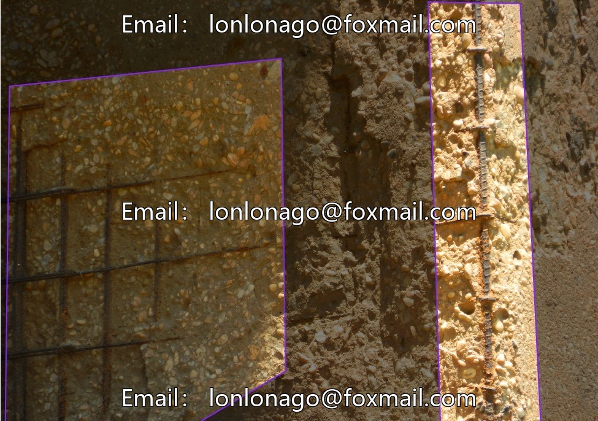
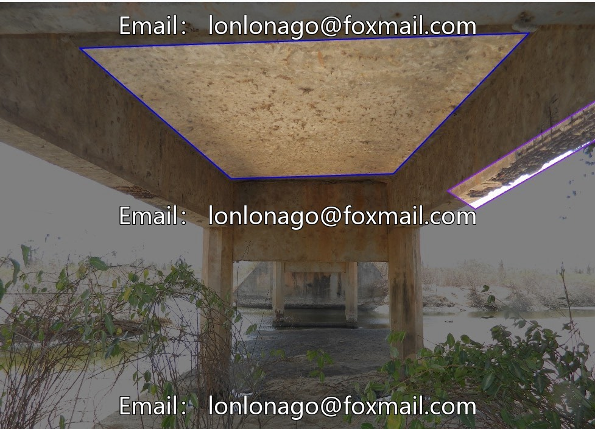
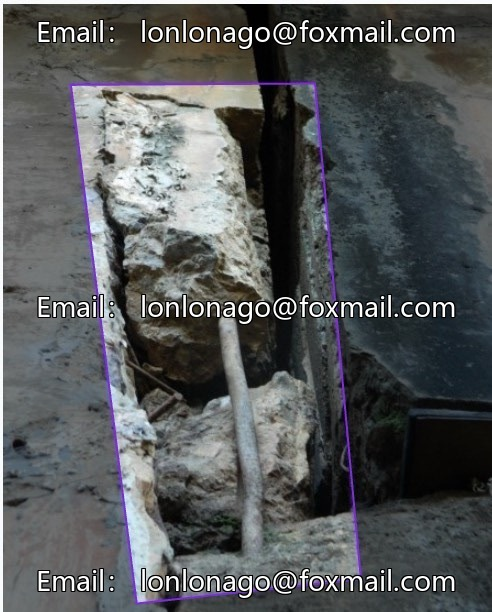
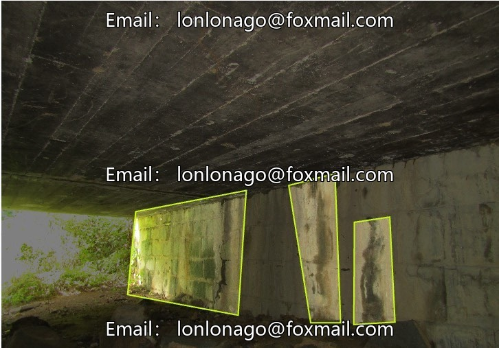
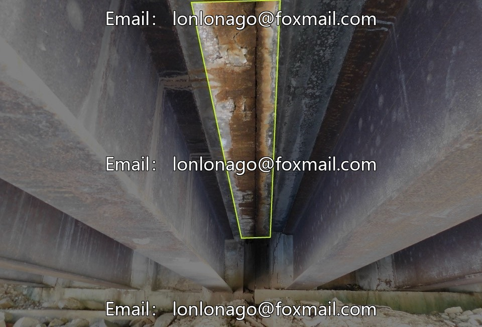

# Bridge Defect Detection Dataset for Unmanned Aerial Inspection, specifically designed for the recognition of concrete structure damage.

## Body

Bridge Defect Detection Dataset for Unmanned Aerial Inspection, specifically designed for concrete structure damage identification and deep learning model training, supporting precise detection of tilt-related defects. Issue 10010.

Data Volume: 2136 actual photos of bridge deterioration, covering 8 common damages (biodegradation, concrete dissolution, cracks, scaling, exposed rebar, mold defects, staining penetration, unclassified), with diverse scenes including beam bridges/arch bridges, day and night, and multiple perspectives.

Supporting Resources: YOLOv5 architecture pre-trained model YOLO-NAS-S, which can be directly deployed for testing.

It is recommended to conduct a data distribution exploration before training, rare categories can be expanded through data augmentation, and enhance the robustness of the model.

Virtual materials, once sold, are non-refundable.
Interested friends, click "I want" to proceed.

## Images

## Payment

Here is a pay link on Stripe ( https://buy.stripe.com/3cs8yP7sY87d0vu9AB ). Please contact me lonlonago@foxmail.com after funding $89, and I will send you a complete data files , thank you!

